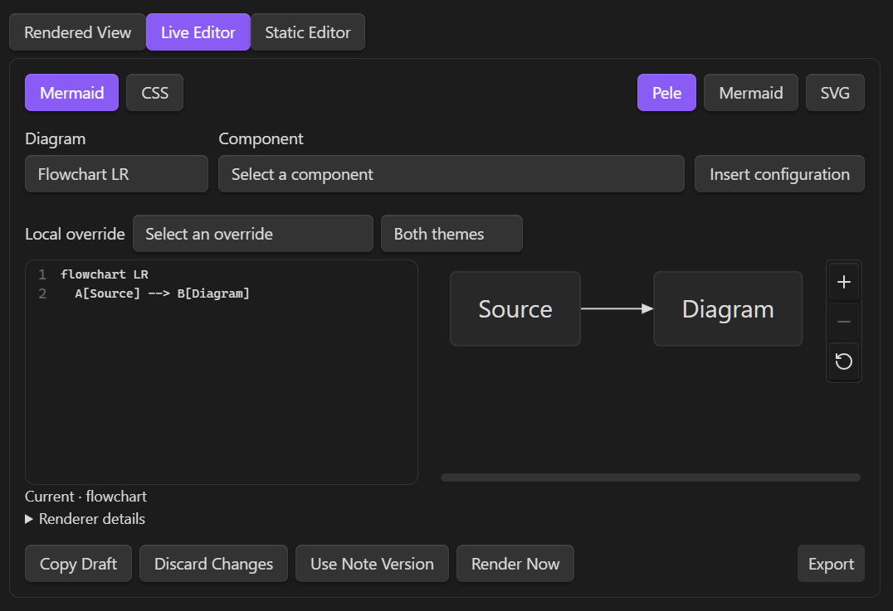
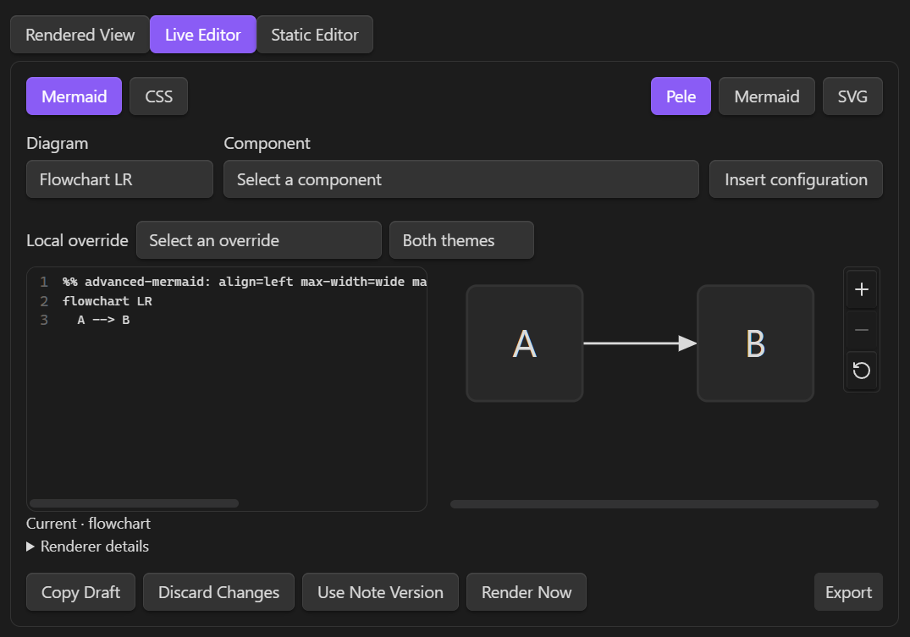

# Advanced Mermaid

Render Mermaid-compatible diagrams locally with Pele 1.12.0 in dedicated `pele` code blocks.
Advanced Mermaid provides inline editing, theme-aware styles, reusable preset classes, and SVG/PNG export. See the [changelog](https://github.com/indubyagee/advanced-mermaid/blob/main/CHANGELOG.md) for version details.

See the [settings menu guide](https://github.com/indubyagee/advanced-mermaid/blob/main/docs/settings-menu.md) for section order, control defaults, inheritance, resets, and editor layout options.

## Diagrams

````markdown
```pele
flowchart LR
  A[Source] --> B[Diagram]
```
````



The plugin uses Obsidian's Markdown code-block processor. Reading view, rendered Live Preview blocks, and embeds are integration targets. Browser fixtures exercise the integration through test adapters; real-device behavior requires separate validation. Source mode remains plain editable Markdown.

## Display settings

Open **Settings → Community plugins → Advanced Mermaid** and select the plugin's settings.

- **Alignment:** left, center, or right; defaults to center.
- **Diagram width:** Normal (700px), Wide (1000px), Maximum (1400px), or Full pane. Each limit is capped by the current pane content width. Only the diagram expands beyond the note's reading width. **By orientation** selects Normal for landscape/square diagrams and Full pane for portrait diagrams.
- **Maximum height:** Short (30vh), Medium (50vh), Tall (75vh), None, or a custom positive decimal in `vh`, `px`, or `rem`. **By orientation** selects None for landscape/square diagrams and Medium for portrait diagrams. `vh` uses the diagram window's viewport height. Zero, negative values, percentages, expressions, and unitless values are rejected.
- **Maintain aspect ratio:** enabled by default. Fit proportionally within both limits. When disabled, fill the bounded dimensions independently; an unlimited height remains proportional to the fitted width.
- **Fill available space:** enabled for new configurations. Allows enlargement to the selected limits. Disable it to retain intrinsic size for smaller diagrams.
- Orientation is determined from intrinsic dimensions before fitting. Layout/direction do not change when height limits or pane widths change. Every rendered Pele diagram has **Zoom In**, **Zoom Out**, and **Reset Zoom** controls in a rail beside the SVG. After zooming, drag to pan or focus the SVG and use the arrow keys. Controls also work in rendered Live Preview and Reading view; source-only Markdown stays editable text.

Existing saved height limits, including `none`, remain in effect. Older configurations migrate with **Fill available space** disabled to preserve their sizing. Select **By orientation** for maximum height and enable **Fill available space** to adopt the new defaults. Foreground color migrates to **Text color**. Settings are saved through the normal plugin settings lifecycle; note source is never rewritten.

Override display settings in one reserved Mermaid comment immediately before the diagram declaration, after optional YAML frontmatter:

````markdown
```pele
%% advanced-mermaid: align=left max-width=wide max-height=30vh aspect-ratio=true fill=true
flowchart LR
  A --> B
```
````



`max-width` accepts `normal`, `wide`, `maximum`, `none`, or `auto`. `max-height` accepts concrete lengths, `short`, `medium`, `tall`, `none`, or `auto`. `aspect-ratio` and `fill` accept `true` or `false`. `auto` selects orientation defaults; `none` removes the additional limit while width stays inside the pane. An omitted key inherits the global setting. Precedence is **diagram override → saved global setting → orientation/plugin default**. Existing `align` and concrete `max-height` directives remain valid.

The marker is case-sensitive. Use at most one directive, with each key at most once; unknown keys and malformed values produce a configuration error. Directives are recognized only in the initial comment/blank-line region after optional frontmatter, before the diagram declaration. Ordinary comments elsewhere are unchanged. The `%% advanced-mermaid:` prefix is reserved; existing notes that previously used that exact prefix as an ordinary initial comment may need adjustment. Fence metadata is not used.

## Theme

Diagram text, lines, surfaces, accents, and fonts follow Obsidian by default. **Style settings** opens named **Global style settings** and **Diagram-specific style settings** pages. The diagram selector offers 16 families. Each color row has independent **Light** and **Dark** selectors and resets; text fields accept hex, RGB/RGBA, and HSL/HSLA and save normalized hex with alpha. **Use global styles** bypasses retained type overrides; scoped reset actions offer undo. Disabling **Follow Obsidian theme** restores Pele color defaults without deleting custom values. Fonts continue inheriting Obsidian's local font families.

Each family also offers **Use custom frontmatter** and a YAML field for defaults such as `config.flowchart.rankSpacing`. These apply to all Pele instances of that family, including Live Editor previews and exports. Frontmatter in an individual source block overrides matching defaults; missing keys inherit. The toggle is independent of **Use global styles** and retains its YAML when disabled. Only valid changes are saved, and notes are never rewritten. See [frontmatter settings and precedence](https://github.com/indubyagee/advanced-mermaid/blob/main/docs/settings-menu.md#styles) for an example and renderer limitations.

Global controls cover background, text, muted text, lines, surfaces, borders, accent, error, source-fill contrast, and eight category colors. **Shared element defaults** preserves the earlier node, edge-label, subgraph, and stroke-width settings. Local family lists, 4-128px measured base labels, and 0-32px corner radii are supported. Text weights remain unavailable because per-role measurement has not been verified for Pele 1.12.0. Specialized paint controls are limited to the tested adapters for Flowchart, State, Sequence, TreeView, Agentflow, and Mindmap; other categories retain common profiles.
Color changes use CSS; font changes refresh Pele's measurements. Source-defined `style`, `classDef`, fills, and fonts keep their own precedence and can remain fixed when themes change. Chart series use Pele's categorical palette unless overridden. Check contrast for your chosen theme and authored colors.

Preset classes apply to Flowchart, State, Agentflow, Mindmap, TreeView, and Treemap. Flowchart nodes and subgraphs use `A[Node]:::ALT1` or `class GROUP ALT1` without a `classDef`. Preset fills/borders/widths override shared defaults; explicit node/subgraph text overrides and authored styles retain precedence. `DEFAULT` is explicit and does not recolor unclassified nodes. New and migrated libraries start with these unchanged colors:

| Class | Fill | Border | Default text |
| --- | --- | --- | --- |
| `DEFAULT` | `#808080` | `#202020` | Black |
| `ALT` | `#151515` | `#505050` | White |
| `ALT1` | `#2D4646` | `#608F94` | White |
| `ALT2` | `#32411E` | `#69823C` | White |
| `ALT3` | `#501E1E` | `#B24C4C` | White |
| `ALT4` | `#46375A` | `#886FAD` | White |
| `ALT5` | `#6E5A28` | `#DAB352` | White |
| `ALT6` | `#5A3250` | `#915082` | White |

Open **Preset class settings** to create/edit classes with a form, edit the complete preset text, or confirm a deletion. The library uses fixed colors in both themes, optional 0–20px stroke widths, and case-sensitive aliases. Missing properties inherit. Later library entries win when an element has multiple preset classes. Empty libraries and deletions persist across reloads. Renaming/deleting never rewrites notes. See [preset syntax and applicability](https://github.com/indubyagee/advanced-mermaid/blob/main/docs/preset-classes.md).

Settings use Obsidian's native declarative pages/groups and appear in settings search. Pixel sizes use numeric inputs, sliders and resets; resetting an optional size restores inheritance.

## Inline editor

In Live Preview, the mode buttons appear in this order: **Rendered View**, **Live Editor**, **Static Editor**. Select **Live Editor** above a complete top-level `pele` or `mermaid` fence, or use **Advanced Mermaid: Toggle inline editor**. **Static Editor** focuses the original fenced Markdown. **Rendered View** is selected when neither editor is active; select it to exit either editor. Esc and toggling an active Live Editor also return to Rendered View. The note cursor moves outside the fence so Live Preview does not immediately reopen source. A fence-only note gains one trailing newline if it has no existing position outside the fence. Explicit static/rendered choices suppress focused-block reopening for that block while its note pane is open. Cached Pele previews resume with the latest saved source on return. Backtick and tilde fences are supported; lists, quotes, and callouts retain ordinary presentation. One inline editor can be active in each pane. Inactive Mermaid blocks and Reading view keep Obsidian's native renderer. Source mode stays plain Markdown.

The **Diagram** menu offers all 33 families supported by Pele, with 55 declaration choices including directions and C4/Railroad variants. Selecting **Flowchart TB** inserts `flowchart TB`, keeping existing frontmatter, comments and body statements. **Component** offers diagram-specific snippets, including classic `A["node"]` and expanded `A@{ shape: rect, label: process }` Flowchart nodes, and inserts at the source position or replaces selected body text. **Insert configuration** adds frontmatter examples for the selected family and fills missing keys while keeping authored values. Each action uses one parent-editor undo step. The menus follow manual declaration edits and are hidden in the CSS tab. See the [syntax controls guide](https://github.com/indubyagee/advanced-mermaid/blob/main/docs/live-editor-syntax.md) for examples, configuration compatibility, and source-preservation details.

The **Local override** selector inserts display directives or registered style variables with valid current values. Style overrides offer Both themes, Light, and Dark targeting. Existing values are selected without replacement; each insertion is one parent-editor undo step. Resolve malformed comments or an invalid/conflicting CSS draft before inserting. Local Pele settings and presets affect inline previews/exports of `mermaid` fences; their native rendering follows Obsidian's own styles.

The source pane has **Mermaid** and **CSS** tabs; output has **Pele**, **Mermaid**, and read-only **SVG** tabs. The source excludes the enclosing fences. Mermaid edits enter the parent note immediately, with one parent undo history. CSS accepts a constrained variable language, validates immediately, and saves a valid draft after the configured delay. Only Mermaid text and visible comments persist:

````markdown
```pele
%% advanced-mermaid-style:v1
%% .pele { --pele-surface: #153030;  --pele-fg: #FFFFFF; }
%% .theme-dark .pele { --pele-surface: #2D4646; }
%% advanced-mermaid-style:end
flowchart LR
 A --> B
```
````


Allowed selectors are `.pele`, `.theme-light .pele`, and `.theme-dark .pele`. Values are literal hex colors, local family names, and bounded `px` lengths. Element controls use registered names such as `--advanced-mermaid-sequence-note-fill`; measured label size uses `--advanced-mermaid-label-size`. Arbitrary properties, URLs, `var()`, imports, private renderer variables, and `!important` are rejected. Malformed comments produce source-line diagnostics and a clearly labeled fallback preview with export disabled.

The preview delay defaults to 250ms (100-1000ms). Layout stacks automatically in narrow panes. Settings also control manual/focused activation, wrapping, line numbers, and optional native comparison. **Render inline diagram** and local Ctrl/Cmd+Enter render immediately; Esc or **Rendered View** exits. Tab indents the current or selected lines; Shift+Tab outdents. Source edits preserve the parent note's viewport, and Enter/Tab stay within the nested editor's keyboard handlers. Three slow renders pause automatic preview while source edits remain committed.

Mermaid and CSS source use the vault's monospace font in a rounded editor with a separate line-number gutter. Preview tabs sit at the top right. Draft actions and **Render Now** share the bottom-left group; **Export** sits at the bottom right with centered text. Controls wrap in narrow panes.

Under **Settings → Advanced Mermaid → Live editor settings → Editor style settings**, **Source font size** retains its existing 8–40 px input, slider, and reset. **Button font size** uses the same controls for all editor buttons, including mode choices and Export. Reset or leave either size empty to inherit. Source text/background and active, inactive, and Export button text/background colors each have independent light/dark pickers, literal color inputs, and resets. Colors support hex, RGB/RGBA, and HSL/HSLA, including alpha. Changes apply to open editors and persist in plugin preferences; diagram labels/styles are separate. Resetting source text color restores syntax highlighting.

The **Zoom** group provides independent **Border color**, **Font color**, and **Background color** pairs for Zoom controls in every Pele render. They override diagram, source, and editor button colors. Empty values use Obsidian interface colors. Enable **Use global styles** to bypass these overrides and use inherited diagram/editor colors; custom Zoom choices remain saved and return when inheritance is turned off. The redundant Close Editor button and its controls are removed; previous Close color preferences remain stored but inactive.

Invalid CSS stays visibly unsaved. **Copy Draft**, **Discard Changes**, and **Use Note Version** protect drafts and conflicting external edits. Closing an invalid draft requires resolving it. Unexpected teardown retains up to ten bounded session drafts, accessible through **Recover inline drafts**; recovery does not survive application exit. An invalid diagram retains a dimmed last-valid preview with current export disabled.

Native Mermaid comparison is opt-in and lazy-loaded from Obsidian. It supports a preflight-validated subset of ordinary Flowchart nodes/arrows and Sequence participants/messages/notes/activations. Configuration directives, HTML, images, callbacks, links, and richer syntax are excluded from comparison before rendering. The adapter preserves host configuration and never initializes the shared engine. Unsupported input reports a native limitation while Pele remains usable. All copy/save actions export the canonical **Pele** result, even during native comparison; SVG output uses the same frozen-style snapshot path.

Settings schema 4 retains earlier display/style/editor values and seeds the original preset library when absent. An explicit empty library stays empty. Unknown newer schemas are loaded conservatively and are not overwritten. Preferences never rewrite a note's style comments. A lazy settings example uses the same controller and is destroyed when hidden.

## Export

Expand the compact **Export** control below the diagram, at the bottom right, using the pointer, touch, or keyboard, then select:


| Action       | Result                                                                                                                                             |
| -------------- | ---------------------------------------------------------------------------------------------------------------------------------------------------- |
| **Copy SVG** | Copies self-contained SVG source as plain text, not an SVG image clipboard format. If clipboard access fails, a dialog provides selectable source. |
| **Save SVG** | Creates a new `.svg` file in a selected existing vault folder.                                                                                     |
| **Copy PNG** | Copies a PNG image when the host supports image clipboard writes and grants access. Otherwise use **Save PNG**.                                    |
| **Save PNG** | Creates a new `.png` file in a selected existing vault folder.                                                                                     |

The save dialog suggests existing vault folders as you type and previews the destination. Select **Vault root** or leave the folder empty to save at the root. Typed paths remain validated. Names derive from the note and a diagram suffix; collisions receive another suffix. Existing files are never overwritten, and no attachment links are inserted into the note. External save dialogs and mobile share sheets are outside this implementation.

Exports contain the full current layout at its intrinsic dimensions, independently of display limits, aspect-ratio stretching, pane size, and zoom/pan state. Font changes can change intrinsic dimensions. SVG styles and an opaque background are resolved before export; alpha backgrounds are composited over white. PNG uses 2× the SVG dimensions, rounded up, with an 8192-pixel side limit and a 16-million-pixel total limit. These are conservative product budgets, not measured mobile hardware limits; oversized PNG exports suggest saving SVG.

SVG fonts are referenced by family and are not embedded. Other devices may substitute fonts. Custom theme/web fonts may also fall back in the browser's SVG-to-PNG path; only the tested local font cases are confirmed. Inspect exports when exact typography matters. Exporting a diagram that changes while preparation is running requires trying again.

## Errors

Invalid directives or diagram syntax show a concise diagnostic and the original source. Available line/column locations refer to the fenced body. Expand **Technical details** or select **Copy Error** for the diagnostic. Edit the source through Obsidian's normal editor to render again. Errors and source are inserted as text, never HTML.

Exports are unavailable for a failed diagram. An export failure keeps the valid diagram visible and reports the failed action separately.

## Diagram image privacy

Advanced Mermaid disables images inside `pele` code blocks to prevent automatic network requests when a note is displayed. Image labels remain visible. There is currently no setting to enable diagram images.

Rendering and exporting introduce no remote services, telemetry, remote code loading, or font downloads. Clipboard writes and export files occur only after selecting an action. The source diagram remains unchanged.

## Build and test

Use npm with Node 20 or newer, as required by the pinned Pele dependency.

```sh
npm ci
npm test
npm run typecheck
npm run test:browser
npm run lint
npm run build
npm run check:public
```

`npm run dev` watches the source. Browser tests use installed Microsoft Edge by default; set `ADVANCED_MERMAID_BROWSER` to another supported Playwright browser channel. They use a disposable browser profile, a loopback fixture server, and stubbed clipboard/vault operations. Set `ADVANCED_MERMAID_OBSIDIAN_ASAR` explicitly to opt into checks using your installed Obsidian assets; otherwise those optional asset checks are skipped. An optional stylesheet can be selected with `ADVANCED_MERMAID_LAYOUT_THEME_CSS`.

## Installation

Build the plugin, then install the generated JavaScript, manifest, and stylesheet in Obsidian's plugin folder named **advanced-mermaid**. Reload Obsidian and enable **Advanced Mermaid** under **Settings → Community plugins**. See the [release files](https://github.com/indubyagee/advanced-mermaid/releases) and [manifest](https://github.com/indubyagee/advanced-mermaid/blob/main/manifest.json).

Plugin-owned note directives and custom CSS variables use the `advanced-mermaid` namespace. When upgrading existing notes or CSS snippets, update their reserved prefixes to the examples in this guide. Installation does not rewrite notes. The `pele` and `mermaid` fence languages remain supported.

The [diagram fixtures](https://github.com/indubyagee/advanced-mermaid/tree/main/tests/fixtures) provide example notes. The real-host probe requires an explicitly selected disposable development vault through `ADVANCED_MERMAID_HOST_VAULT` and an already-running local debugging endpoint selected through `ADVANCED_MERMAID_HOST_CDP`. It creates test notes and a temporary plugin, and checks installed-plugin preferences; it is a separate, opt-in developer test. See the [host probe source](https://github.com/indubyagee/advanced-mermaid/blob/main/scripts/host-v02-test.mjs).

## Publication checks

The public-source check rejects tracked internal plans, design records, agent instructions, settings data, generated output, workstation paths, and common credential formats. Internal records remain local and excluded; public user guides are linked from this README. Package contents are restricted to the plugin artifacts and public release documentation, and npm publication is disabled.

Enable the [pre-push hook](https://github.com/indubyagee/advanced-mermaid/blob/main/.githooks/pre-push) with `git config --local core.hooksPath .githooks` to check outgoing Git history. `npm run check:history` reviews the current history without pushing. Removing a tracked document does not remove earlier committed copies; history must pass this check before it is published. Neither check can identify every possible form of sensitive information.

## Verification status and troubleshooting

Unit and browser checks cover display settings, source directives, style validation, editor behavior, exports, and cleanup through test adapters. A real Obsidian host, mobile devices, pop-out editors, and physical clipboard/touch/IME behavior require separate validation after changes. The manifest permits mobile loading; that is not a claim of device testing.

- **No diagram:** verify the fence language is `pele`; inspect the displayed diagnostic.
- **Height did not change:** check for a per-diagram override and use an accepted unit or `none`.
- **Colors do not follow the theme:** check custom settings and source-defined styles.
- **Copy failed:** keep the diagram window focused and try again; use selectable SVG source or save the file.
- **PNG is too large or looks different:** save SVG or simplify the diagram; verify local font availability.
- **Plugin does not load:** run `npm run build` and confirm all three installation files are at the plugin folder's top level.
