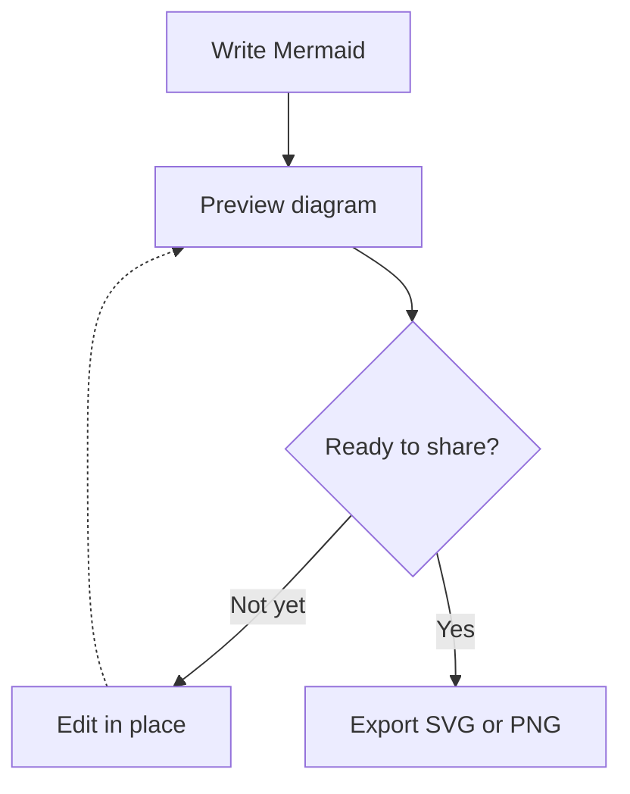
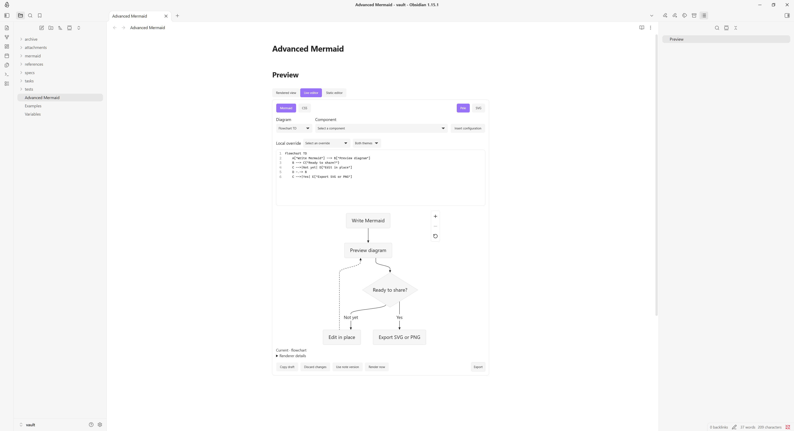
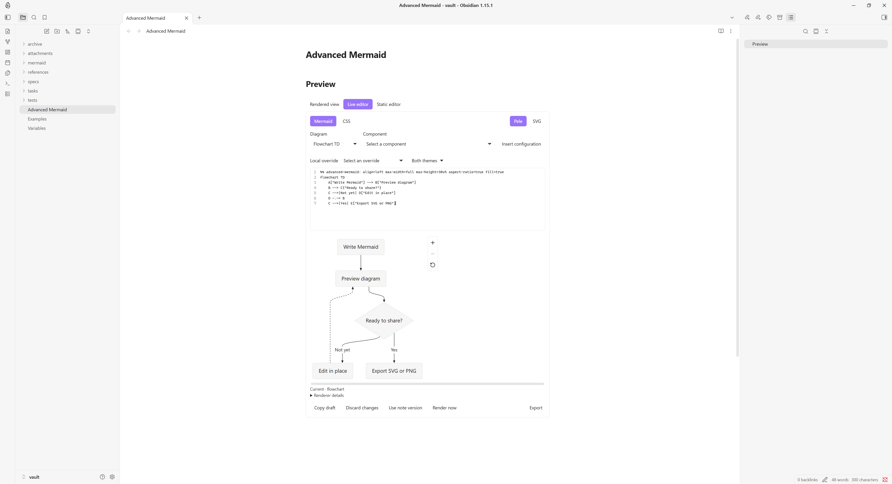
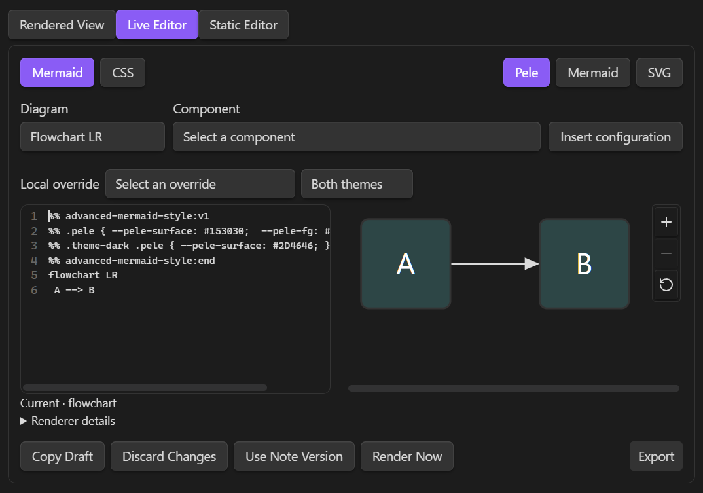

# Advanced Mermaid

<script type="text/javascript" src="https://cdnjs.buymeacoffee.com/1.0.0/button.prod.min.js" data-name="bmc-button" data-slug="indubyagee" data-color="#FFDD00" data-emoji="" data-font="Inter" data-text="Buy me a coffee" data-outline-color="#000000" data-font-color="#000000" data-coffee-color="#ffffff" ></script>

Render Mermaid-compatible diagrams with Pele 1.12.0 in `mermaid` or `pele` code blocks.
Advanced Mermaid provides inline editing, theme-aware styles, reusable preset classes, and SVG/PNG export. This README describes the current development version, including changes listed under **Unreleased** in the [changelog](https://github.com/indubyagee/advanced-mermaid/blob/main/CHANGELOG.md).

**Compatibility:** requires Obsidian 1.14.5 or newer and is desktop-only. Mobile loading is disabled.

See the [settings menu guide](https://github.com/indubyagee/advanced-mermaid/blob/main/docs/settings-menu.md) for section order, control defaults, inheritance, resets, and editor layout options.

## Diagrams

````markdown

````



Both `mermaid` and `pele` code blocks use Advanced Mermaid in Reading view, rendered Live Preview blocks, and embeds while the plugin is enabled. Existing `pele` blocks remain supported. Source mode remains plain editable Markdown.

## Display settings

Open **Settings → Community plugins → Advanced Mermaid** and select the plugin's settings.

**Diagram width** defaults to **Default**. Its options depend on whether Minimal Theme Settings (MTS) is enabled.

| MTS state | Diagram width options |
| --- | --- |
| Enabled | Default, Normal, Wide, Maximum, Full Pane |
| Disabled or absent | Default, Full |

**Default** preserves the renderer's native width within the text column and height limit. **Full** uses the text column as its width limit, and **Full Pane** uses the usable pane width. The Live editor uses its preview column as the boundary.

Normal, Wide, and Maximum use the active values configured in MTS. Maximum caps Normal and Wide. Disabling MTS switches to native or text-column sizing and ignores saved MTS width values. These rules apply in Reading view and Live Preview.

- **Alignment:** `left`, `center`, or `right`; defaults to `center`.
- **Maximum height:** Short (30vh), Medium (50vh), Tall (75vh), None, or a custom positive decimal in `vh`, `px`, or `rem`. **By orientation** selects None for landscape/square diagrams and Medium for portrait diagrams. `vh` uses the diagram window's viewport height. Zero, negative values, percentages, expressions, and unitless values are rejected.
- **Maintain aspect ratio:** enabled by default. Fit proportionally within both limits. When disabled, fill the bounded dimensions independently; an unlimited height remains proportional to the fitted width.
- **Fill available space** defaults to off. Enable it to enlarge smaller diagrams up to the selected limits. Default width retains native sizing even when this is enabled.
- Orientation is determined from intrinsic dimensions before fitting. Layout/direction do not change when height limits or pane widths change. Reading view and Live Preview's **Rendered view** use the full diagram block for zoom and pan. The controls sit at the bottom right for left-aligned diagrams and at the bottom left for centered or right-aligned diagrams. The **Live editor** preview places the controls beside the SVG. After zooming, drag to pan or focus the SVG and use the arrow keys.

Saved **By orientation** width selections migrate to **Default**. Saved MTS presets use Default while MTS is absent or disabled, and saved Full Pane selections use Full. Foreground color migrates to **Text color**.

Override display settings in one reserved Mermaid comment immediately before the diagram declaration, after optional YAML frontmatter:

````markdown

````


`max-width` accepts `default`, `full`, `normal`, `wide`, `maximum`, `none`, or `auto`. Default retains native sizing. Full uses Full Pane when MTS is enabled and the text column otherwise. With MTS enabled, `none` selects Full Pane and `auto` selects Normal for landscape and square diagrams or Full Pane for portrait diagrams. With MTS absent or disabled, Normal, Wide, and Maximum use Default, and `none` uses Full. `max-height` accepts concrete lengths, `short`, `medium`, `tall`, `none`, or `auto`. For height, `none` removes the height cap and `auto` uses the orientation defaults. `aspect-ratio` and `fill` accept `true` or `false`.

The marker is case-sensitive. Use at most one directive, with each key at most once; unknown keys and malformed values produce a configuration error. Directives are recognized only in the initial comment/blank-line region after optional frontmatter, before the diagram declaration. Ordinary comments elsewhere are unchanged. The `%% advanced-mermaid:` prefix is reserved; existing notes that previously used that exact prefix as an ordinary initial comment may need adjustment. Fence metadata is not used.

## Theme

Diagram text, lines, surfaces, accents, and fonts follow Obsidian by default. **Style settings** opens named **Global style settings** and **Diagram-specific style settings** pages. The diagram selector offers 16 families. Each color row has independent **Light** and **Dark** selectors and resets; text fields accept hex, RGB/RGBA, and HSL/HSLA and save normalized hex with alpha. **Use global styles** bypasses retained type overrides; scoped reset actions offer undo. Disabling **Follow Obsidian theme** restores Pele color defaults without deleting custom values. Fonts continue inheriting Obsidian's local font families.

Each family also offers **Use custom frontmatter** and a YAML field for defaults such as `config.flowchart.rankSpacing`. These apply to all Pele instances of that family, including Live editor previews and exports. Frontmatter in an individual source block overrides matching defaults; missing keys inherit. The toggle is independent of **Use global styles** and retains its YAML when disabled. Only valid changes are saved, and notes are never rewritten. See [frontmatter settings and precedence](https://github.com/indubyagee/advanced-mermaid/blob/main/docs/settings-menu.md#styles) for an example and renderer limitations.

Global controls cover background, text, muted text, lines, surfaces, borders, accent, error, source-fill contrast, and eight category colors. **Shared element defaults** preserves the earlier node, edge-label, subgraph, and stroke-width settings. Local family lists, 4-128px measured base labels, and 0-32px corner radii are supported. Text weights remain unavailable because per-role measurement has not been verified for Pele 1.12.0. Specialized paint controls are limited to the tested adapters for Flowchart, State, Sequence, TreeView, Agentflow, and Mindmap; other categories retain common profiles.
Color changes use CSS; font changes refresh Pele's measurements. Source-defined `style`, `classDef`, fills, and fonts keep their own precedence and can remain fixed when themes change. Chart series use Pele's categorical palette unless overridden. Check contrast for your chosen theme and authored colors.

Preset classes apply to Flowchart, State, Agentflow, Mindmap, TreeView, and Treemap. Assign them to Flowchart nodes with `A[Node]:::PRESET3` or to subgraphs with `class GROUP PRESET3`. Preset fills, borders, and widths override shared defaults. Explicit node or subgraph text colors and authored styles take precedence. The 42-class built-in library includes `PRESET1`–`PRESET8`, `CATEGORY1`–`CATEGORY8`, and aliases for highlights, notes, statuses, and diagram roles. It is used only when no saved library exists; upgrades retain saved libraries, including empty ones.

Open **Preset class settings** to create/edit classes with a form, edit the complete preset text, or confirm a deletion. The library uses fixed colors in both themes, optional 0–20px stroke widths, and case-sensitive aliases. Missing properties inherit. Later library entries win when an element has multiple preset classes. Empty libraries and deletions persist across reloads. Renaming/deleting never rewrites notes. See [preset syntax and applicability](https://github.com/indubyagee/advanced-mermaid/blob/main/docs/preset-classes.md).

Settings use Obsidian's native declarative pages/groups and appear in settings search. Pixel sizes use numeric inputs, sliders and resets; resetting an optional size restores inheritance.

## Inline editor

In Live Preview, the mode buttons appear in this order: **Rendered view**, **Live editor**, **Static editor**. Select **Live editor** above a complete top-level `pele` or `mermaid` fence, or use **Advanced Mermaid: Toggle inline editor**. **Static editor** focuses the original fenced Markdown. **Rendered view** is selected when neither editor is active; select it to exit either editor. Esc and toggling an active Live editor also return to Rendered view. The note cursor moves outside the fence so Live Preview does not immediately reopen source. A fence-only note gains one trailing newline if it has no existing position outside the fence. Explicit static/rendered choices suppress focused-block reopening for that block while its note pane is open. Cached Pele previews resume with the latest saved source on return. Backtick and tilde fences are supported; lists, quotes, and callouts retain ordinary presentation. One inline editor can be active in each pane. Both fence languages use Advanced Mermaid in rendered blocks and Reading view. Source mode stays plain Markdown.

The **Diagram** menu offers all 33 families supported by Pele, with 55 declaration choices including directions and C4/Railroad variants. Selecting **Flowchart TB** inserts `flowchart TB`, keeping existing frontmatter, comments and body statements. **Component** offers diagram-specific snippets, including classic `A["node"]` and expanded `A@{ shape: rect, label: process }` Flowchart nodes, and inserts at the source position or replaces selected body text. **Insert configuration** adds frontmatter examples for the selected family and fills missing keys while keeping authored values. Each action uses one parent-editor undo step. The menus follow manual declaration edits and are hidden in the CSS tab. See the [syntax controls guide](https://github.com/indubyagee/advanced-mermaid/blob/main/docs/live-editor-syntax.md) for examples, configuration compatibility, and source-preservation details.

The **Local override** selector inserts display directives or registered style variables with valid current values. Style overrides offer Both themes, Light, and Dark targeting. Existing values are selected without replacement; each insertion is one parent-editor undo step. Resolve malformed comments or an invalid/conflicting CSS draft before inserting. Local Pele settings and presets apply to rendered diagrams, inline previews, and exports of both fence languages.

The source pane has **Mermaid** and **CSS** tabs. The preview pane has **Pele** and read-only **SVG** tabs. The source excludes the enclosing fences. Mermaid edits enter the parent note immediately and share its undo history. CSS accepts a constrained variable language, validates immediately, and saves valid drafts after the configured delay.

````markdown
```pele
%% mermaidnced-mermaid-style:v1
%% .pele { --pele-surface: #
%% .pele { --pele-surface: #153030;  --pele-fg: #FF0000; }
%% .theme-dark .pele { --pele-surface: #2D4646; }
%% advanced-mermaid-style:end
flowchart TD
    A["Write Mermaid"] --> B["Preview diagram"]
    B --> C{"Ready to share?"}
    C -->|Not yet| D["Edit in place"]
    D -.-> B
    C -->|Yes| E["Export SVG or PNG"]
````


light-flowchart-overrides-2
Allowed selectors are `.pele`, `.theme-light .pele`, and `.theme-dark .pele`. Values are literal hex colors, local family names, and bounded `px` lengths. Element controls use registered names such as `--advanced-mermaid-sequence-note-fill`; measured label size uses `--advanced-mermaid-label-size`. Arbitrary properties, URLs, `var()`, imports, private renderer variables, and `!important` are rejected. Malformed comments produce source-line diagnostics and a clearly labeled fallback preview with export disabled.

The preview delay defaults to 250ms (100–1000ms). **Editor layout** offers Auto (the default), Side by side, and Stacked; narrow panes always stack. Settings also control activation, wrapping, and line numbers. **Render inline diagram** and Ctrl/Cmd+Enter render immediately. Press Esc or select **Rendered view** to exit. Tab indents the current or selected lines. Shift+Tab outdents. Source edits preserve the parent note's viewport, and Enter and Tab stay within the nested editor. Three slow renders pause automatic preview while source edits continue to save.

Mermaid and CSS source use the vault's monospace font in a rounded editor with a separate line-number gutter. Preview tabs sit at the top right. Draft actions and **Render now** share the bottom-left group, and **Export** sits at the bottom right. Buttons use flat styling and wrap in narrow panes.

Under **Settings → Advanced Mermaid → Live editor settings → Editor style settings**, **Source font size** and **Button font size** each accept 8–40 px through an input, slider, and reset. Source font size defaults to 10 px. Reset or leave either size empty to inherit. **Button corner radius** accepts 0–32 px for editor buttons, dropdowns, and Export; reset it to inherit the theme's corners. Source text/background and active, inactive, and Export button text/background/border colors each have independent light/dark pickers, literal color inputs, and resets. Dropdowns use inactive button colors. **Export** and its copy and save buttons use the Export colors, shared button font size, and corner radius in all views. Colors support hex, RGB/RGBA, and HSL/HSLA, including alpha. Changes apply to open editors and persist in plugin preferences. Resetting source text color restores syntax highlighting.

The **Zoom** group provides independent **Border color**, **Font color**, and **Background color** pairs for Zoom controls in every Pele render. They override diagram, source, and editor button colors. Empty values use Obsidian interface colors. Enable **Use global styles** to bypass these overrides and use inherited diagram/editor colors; custom Zoom choices remain saved and return when inheritance is turned off. The redundant Close Editor button and its controls are removed; previous Close color preferences remain stored but inactive.

Invalid CSS stays visibly unsaved. **Copy draft**, **Discard changes**, and **Use note version** protect drafts and conflicting external edits. Closing an invalid draft requires resolving it. Unexpected teardown retains up to ten bounded session drafts, accessible through **Recover inline drafts**; recovery does not survive application exit. An invalid diagram retains a dimmed last-valid preview with current export disabled.

Settings schema 6 adds Default and Full width selections. Existing saved width preferences remain available when MTS is enabled. The plugin uses the built-in presets when a vault has no saved preset library. An explicit empty library stays empty. The plugin preserves settings saved by newer versions and leaves note comments intact. The settings example uses the same renderer and loads when expanded.

## Export

Expand the compact **Export** control below the diagram, at the bottom right, using the pointer, touch, or keyboard, then select:

| Action       | Result                                                                                                                                             |
| -------------- | ---------------------------------------------------------------------------------------------------------------------------------------------------- |
| **Copy SVG** | Copies self-contained SVG source as plain text, not an SVG image clipboard format. If clipboard access fails, a dialog provides selectable source. |
| **Save SVG** | Creates a new `.svg` file in a selected existing vault folder.                                                                                     |
| **Copy PNG** | Copies a PNG image when the host supports image clipboard writes and grants access. Otherwise use **Save PNG**.                                    |
| **Save PNG** | Creates a new `.png` file in a selected existing vault folder.                                                                                     |

The save dialog suggests existing vault folders as you type and previews the destination. Select **Vault root** or leave the folder empty to save at the root. Typed paths remain validated. Names derive from the note and a diagram suffix; collisions receive another suffix. Existing files are never overwritten, and no attachment links are inserted into the note. External save dialogs and mobile share sheets are outside this implementation.

Exports contain the full current layout at its intrinsic dimensions, independently of display limits, aspect-ratio stretching, pane size, and zoom/pan state. Font changes can change intrinsic dimensions. SVG styles and an opaque background are resolved before export; alpha backgrounds are composited over white. PNG uses 2× the SVG dimensions, rounded up, with an 8192-pixel side limit and a 16-million-pixel total limit. These are conservative product budgets, not measured mobile hardware limits; oversized PNG exports suggest saving SVG.

SVG fonts are referenced by family and are not embedded. Other devices may substitute fonts. Custom theme/web fonts may also fall back in the browser's SVG-to-PNG path; only the tested local font cases are confirmed. Inspect exports when exact typography matters. Exporting a diagram that changes while preparation is running requires trying again.

## Errors

Invalid directives or diagram syntax show a concise diagnostic and the original source. Available line/column locations refer to the fenced body. Expand **Technical details** or select **Copy error** for the diagnostic. Edit the source through Obsidian's normal editor to render again. Errors and source are inserted as text, never HTML.

Exports are unavailable for a failed diagram. An export failure keeps the valid diagram visible and reports the failed action separately.

## Diagram image privacy

Advanced Mermaid disables images inside `pele` and `mermaid` code blocks to prevent automatic network requests when a note is displayed. Image labels remain visible. There is currently no setting to enable diagram images.

Rendering and exporting introduce no remote services, telemetry, remote code loading, or font downloads. Clipboard writes and export files occur only after selecting an action. The source diagram remains unchanged.

## Installation

To install a [GitHub release](https://github.com/indubyagee/advanced-mermaid/releases) manually:

1. Download `main.js`, `manifest.json`, and `styles.css` from the same release, or generate them with `npm run build`.
2. Place all three files directly in `<Vault>/.obsidian/plugins/advanced-mermaid/`.
3. Reload Obsidian and enable **Advanced Mermaid** under **Settings → Community plugins**.

After the listing is published, open **Settings → Community plugins → Browse**, search for **Advanced Mermaid**, then select **Install** and **Enable**. Both `mermaid` and `pele` blocks use the plugin's local renderer while it is enabled.

Plugin-owned note directives and custom CSS variables use the `advanced-mermaid` namespace. When upgrading existing notes or CSS snippets, update their reserved prefixes to the examples in this guide. Installation does not rewrite notes. The `pele` and `mermaid` fence languages remain supported.

## Development

From the repository root, install dependencies and build the plugin:

```sh
npm install
npm run build
```

The build checks TypeScript and bundles `src/main.ts` into `main.js`. Install that file with the repository's `manifest.json` and `styles.css` using the steps above. Keep generated `main.js` and `node_modules/` out of version control.

| Command | Purpose |
| --- | --- |
| `npm run dev` | Rebuild automatically while editing source. |
| `npm test` | Run unit and script tests. |
| `npm run typecheck` | Check TypeScript for source and test fixtures. |
| `npm run lint` | Run ESLint, including Obsidian-specific rules. |
| `npm run test:browser` | Run browser fixtures using Microsoft Edge by default. |

Browser fixtures use an Obsidian test adapter. Verify changes in Obsidian separately before claiming host compatibility.

## License and credits

Advanced Mermaid uses the MIT license. Its bundled renderer, [Pele 1.12.0](https://github.com/obsidianmd/pele), uses the MIT license and includes a Lucide reset icon under the ISC license. The generated JavaScript contains the complete project and Pele license notices, including the Lucide notice.

## Platform coverage and troubleshooting

The recorded Windows acceptance covers the exact 0.3.0 production artifacts on Obsidian 1.14.5 and 1.15.0, including settings persistence, editor modes, undo, draft recovery, SVG/PNG clipboard and save actions, embeds, multiple panes, pop-outs, and unload/re-enable cleanup. Those results do not establish host acceptance for Unreleased changes. macOS and Linux host behavior, mobile devices, touch, and IME behavior remain unverified. Mobile loading is disabled.

- **No diagram:** verify the fence language is `mermaid` or `pele`; inspect the displayed diagnostic.
- **Height did not change:** check for a per-diagram override and use an accepted unit or `none`.
- **Width settings have no effect** — check the diagram's local override and whether MTS is enabled. Default preserves native width. To enlarge a smaller diagram, select another available width and enable **Fill available space**.
- **Colors do not follow the theme:** check custom settings and source-defined styles.
- **Copy failed:** keep the diagram window focused and try again; use selectable SVG source or save the file.
- **PNG is too large or looks different:** save SVG or simplify the diagram; verify local font availability.
- **Plugin does not load:** confirm all three installation files are at the plugin folder's top level.
