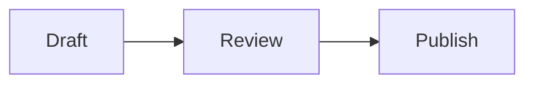

# Advanced Mermaid

Edit a Mermaid diagram and see it update in the same Obsidian note. Advanced Mermaid lets you match diagrams to your light or dark theme, reuse styles across notes, and export diagrams as SVG or PNG. You can also turn a flowchart or Agentflow diagram into an editable Obsidian Canvas.

**Requires Obsidian 1.14.5 or later on desktop.**

## Installation

1. In Obsidian, open **Settings → Community plugins**. If prompted, select **Turn on community plugins**.
2. Select **Browse** and search for **Advanced Mermaid**.
3. Select **Install**, then **Enable**.

[View the Obsidian plugin listing](https://community.obsidian.md/plugins/advanced-mermaid) · [Install manually from GitHub](docs/user-guide.md#install-manually)

## Try a diagram

Copy this block, including the backticks, into a blank note.

````markdown

````

In **Live Preview**, add a blank line after the block and move the cursor there to see the flowchart. Select **Live editor** above the diagram and change `Draft` to `Plan` in the source. The preview updates as you type. You can also view the diagram in **Reading view**.

While the plugin is enabled, it renders both `mermaid` and `pele` code blocks using Pele, a Mermaid-compatible renderer. Some diagrams may look different because Pele handles layout and styling in its own way. [Pele compatibility](https://pele.run/compatibility)

## Documentation

- [User Guide](docs/user-guide.md) for editing, styling, exporting, and troubleshooting.
- [Technical reference](docs/technical-reference.md) for configuration syntax, rendering behavior, and development.
- [Changelog](CHANGELOG.md) for release notes.

## License and credits

Advanced Mermaid and its bundled renderer, Pele, use the MIT license. [Project license](LICENSE) · [Pele source](https://github.com/obsidianmd/pele)

[Support the project on Buy Me a Coffee](https://buymeacoffee.com/indubyagee)
