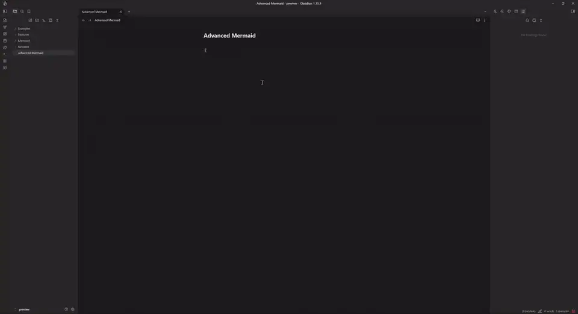
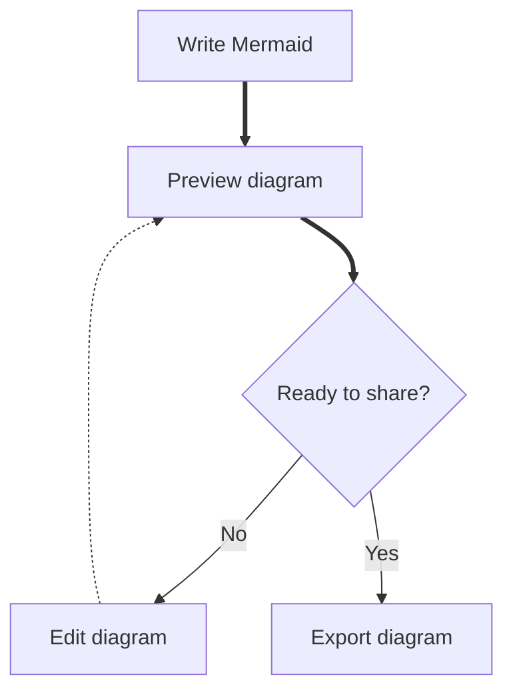
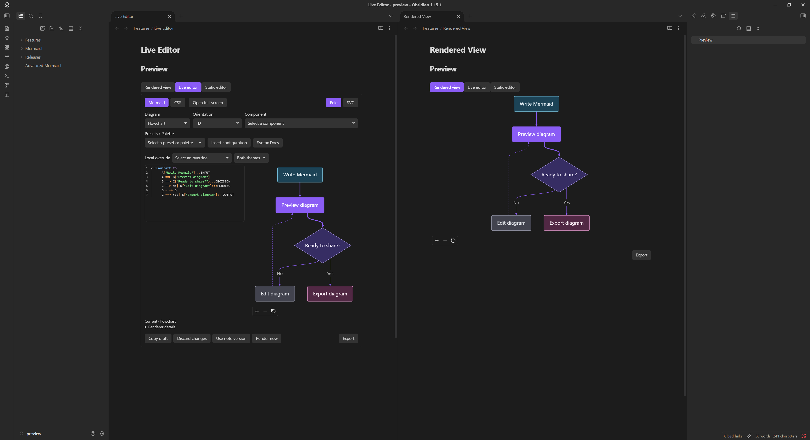
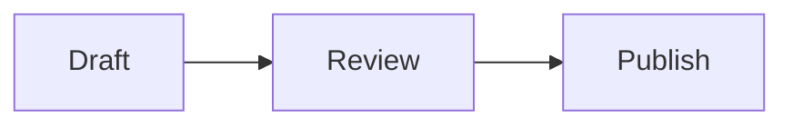

# Advanced Mermaid

[](LICENSE)
[](https://github.com/indubyagee/advanced-mermaid/releases/latest)
[](https://github.com/indubyagee/advanced-mermaid)
[](https://community.obsidian.md/plugins/advanced-mermaid)
[][ko-fi]
[][buy-me-a-coffee]

Edit Mermaid diagrams inside inline and full-screen Live Editors. Advanced Mermaid lets you match diagrams to the vault theme, reuse styles and presets across notes, export diagrams as SVG or PNG, and turn Flowchart and Agentflow diagrams into editable Obsidian Canvases.

**Requires Obsidian 1.14.5 or later on desktop.**



````markdown

````



## Installation

1. In Obsidian, open **Settings → Community plugins**. If prompted, select **Turn on community plugins**.
2. Select **Browse** and search for **Advanced Mermaid**.
3. Select **Install**, then **Enable**.

[View the Obsidian plugin listing](https://community.obsidian.md/plugins/advanced-mermaid) · [Install manually from GitHub](docs/user-guide.md#install-manually)

## Try a diagram

Copy this block, including the backticks, into a blank note.

````markdown

````

In **Live Preview**, add a blank line after the block and move the cursor there to see the flowchart. Select **Live editor** above the diagram and change `Draft` to `Plan` in the source. The preview updates as you type. Select **Open full-screen** to move the editor into a dedicated tab. You can also view the diagram in **Reading view**.

While the plugin is enabled, it renders both `mermaid` and `pele` code blocks using Pele, a Mermaid-compatible renderer. Some diagrams may look different because Pele handles layout and styling in its own way. [Pele compatibility](https://pele.run/compatibility)

## Documentation

- [User Guide](docs/user-guide.md) for editing, styling, exporting, and troubleshooting.
- [Technical reference](docs/technical-reference.md) for configuration syntax, rendering behavior, and development.
- [Contributing](CONTRIBUTING.md) for reporting issues, testing changes, and opening pull requests.
- [Changelog](CHANGELOG.md) for release notes.

## License and credits

Advanced Mermaid and its bundled renderer, Pele, use the MIT license. [Project license](LICENSE) · [Pele source](https://github.com/obsidianmd/pele)

Support the project on [Ko-fi][ko-fi] or [Buy Me a Coffee][buy-me-a-coffee].

[ko-fi]: https://ko-fi.com/C0N32AZ7AW
[buy-me-a-coffee]: https://buymeacoffee.com/indubyagee
