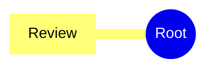

# Preset classes

Open **Settings → Advanced Mermaid → Preset class settings**. Create a class with the
form or select **Edit preset text** to edit the whole library. Both editors save
only complete, valid entries. Cancel leaves the saved library alone; deletion
requires confirmation. A renamed alias is not updated in notes.

The eight original classes are seeded during migration. Each class has an alias
and optional text, fill, stroke, and stroke-width values. Colors stay fixed across
themes. Empty fields inherit, and widths accept 0–20 px, including fractions.
If several classes match an element, later library entries override only the
properties they define.

## Text format

```yaml
preset:
  - alias: Review
    fill: "#50505080"
    stroke: "#808080"
    text: "#ffffff"
    width: 1.5px
```

The editor accepts the specification's unquoted hex colors as literals, as well
as literal RGB/RGBA and HSL/HSLA colors. Generated text quotes colors and normalizes
them to hex, retaining alpha. This is a restricted preset format: two-space alias
entries, four-space fields, and no general YAML objects, anchors, tags or imports.
Use `preset: []` for an empty library; it remains empty after reload.

Aliases contain 1–64 letters, digits, underscores or hyphens, beginning with a
letter or underscore. They are case-sensitive and unique. Renderer names such as
`pele-*`, `theme-*` and lowercase `default` are reserved. Uppercase `DEFAULT`
remains an ordinary explicit preset.

## Assigning classes

| Family | Source syntax |
| --- | --- |
| Flowchart | `A[Review]:::Review` or `class A Review`; `class GROUP Review` for a subgraph |
| State | `class A Review` after declaring the state; composite states are supported |
| Agentflow | `A[Task]:::Review` |
| Mindmap | Put `:::Review` on the decoration line immediately after the node |
| TreeView | `file.ts :::Review` or `folder/ :::Review` — retain the separating space |
| Treemap | `"Item": 10:::Review` |

For example:



Preset properties apply to existing shapes and labels. TreeView names and
text-only Mindmap nodes have no background shape, so fill/border/width values do
not add one. Edges, icons and unrelated diagram families are not preset targets.

Authored Mermaid `style` and `classDef` paint retain precedence. Explicit shared
node/subgraph text colors also retain their existing precedence over preset text.
Preset colors, alpha and widths use the same preparation for live previews and
self-contained SVG/PNG exports. Raw SVG source references local fonts as before.

For a `mermaid` fence, presets apply while the inline editor renders the block and to its
Pele exports. Inactive blocks and Reading view use Obsidian's native styling.
