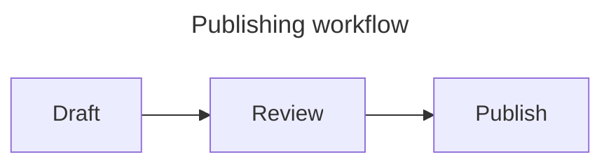

# Advanced Mermaid technical reference

Advanced Mermaid is a desktop Obsidian plugin written in TypeScript. The production build bundles Pele 1.12.0 into `main.js` and uses Obsidian’s runtime for its plugin and editor APIs. [User Guide](user-guide.md) · [Pele compatibility](https://pele.run/compatibility)

## Build and test locally

Use npm and Node.js 24, the version used for release builds. From the repository root, run the following commands.

```sh
npm ci
npm run build
```

The build checks TypeScript and bundles [`src/main.ts`](../src/main.ts) with esbuild. To load the build in a test vault, copy the generated `main.js` along with `manifest.json` and `styles.css` to the plugin folder and enable it in Obsidian. [Manual installation](user-guide.md#install-manually)

| Command | What it checks or does |
| --- | --- |
| `npm run dev` | Rebuilds the bundle when source files change. |
| `npm test` | Runs unit and script tests. |
| `npm run typecheck` | Type-checks the plugin source and test fixtures. |
| `npm run lint` | Checks the code with ESLint, including Obsidian plugin rules. |
| `npm run test:browser` | Runs browser fixtures with Playwright and Microsoft Edge by default. |
| `npm run check:public` | Checks the public worktree for private or generated files and disallowed text patterns. |
| `npm run check:history` | Runs the public-worktree checks and inspects history reachable from `HEAD`. |
| `npm run check:release` | Checks version metadata, release files, and the bundled license notices after a build. |

To run the browser fixtures with Chromium as in CI, run `npx playwright install chromium` and set `ADVANCED_MERMAID_BROWSER` to `chromium`. The fixtures use an Obsidian test adapter. Use a test vault in the actual app to verify host behavior such as editor handoff, settings, clipboard access, and pop-out windows.

## How a diagram renders

1. The plugin registers Markdown code-block processors for `pele` and `mermaid`. The `mermaid` processor runs before Obsidian’s built-in processor. The CodeMirror extension indexes eligible fences in Live Preview and manages the editor modes. [Plugin entry point](../src/main.ts) · [Editor extension](../src/editor/extension.ts) · [Fence index](../src/editor/fences.ts)
2. The inline editor takes ownership of a block within its pane and suspends its ordinary preview. It sends Mermaid edits to the note’s CodeMirror editor so they use normal save and undo behavior. When the inline editor closes, the ordinary preview resumes with the latest source. [Ownership](../src/editor/ownership.ts) · [Source bridge](../src/editor/source-bridge.ts)
3. A shared controller checks the source size, resolves display overrides, styles, and frontmatter, then mounts or updates Pele. Settings changes can reuse the current render when the configured source and measured label size match. Changes to fonts can trigger a new measurement. [Rendering controller](../src/rendering/controller.ts)
4. The display layer fits the SVG to the text column, usable pane, or inline preview column. It determines orientation from the diagram’s intrinsic dimensions. The fitted dimensions control how the diagram appears in the note. Pele handles zoom and pan inside that display. [Layout](../src/rendering/layout.ts) · [Sizing](../src/rendering/sizing.ts)

The renderer runs locally with images disabled. The controller displays errors and source as text. It can keep a dimmed last-valid render in the Live editor or show a fallback when local styles are invalid. Copy and save actions require a current, valid render. [Diagram diagnostics](../src/ui/diagram-error.ts)

### Editor state and lifecycle

The Mermaid tab commits changes to the note as you edit. The CSS tab validates its draft and commits valid changes as a comment region after the configured delay. The delay defaults to 250 ms and accepts 100–1000 ms. After three consecutive slow renders, automatic preview pauses and **Render now** remains available.

Unexpected teardown can keep up to ten bounded recovery drafts in memory for the current Obsidian session. Unloading the plugin destroys its editor and rendering components and disposes of their listeners and pending work. [Live editor](../src/editor/live-editor.ts) · [Preview scheduler](../src/editor/preview-scheduler.ts) · [Recovery drafts](../src/editor/drafts.ts)

## Settings and precedence

Preferences use Obsidian’s plugin data API. The current settings schema is 6. Normalization maps legacy foreground values to text color and migrates old orientation-based global widths to **Default**. The plugin seeds the built-in preset library when the saved library is absent and preserves a saved empty library. A newer schema can be loaded with recognized values, with saving disabled to protect the newer settings. [Settings schema](../src/settings.ts)

| Setting | How it is resolved |
| --- | --- |
| Display | Values present in the block’s display comment override the corresponding plugin settings. Omitted values use the plugin settings. |
| Style | Start with theme or renderer defaults. Apply **All diagrams**, then enabled overrides for the diagram type, then CSS variables from the block. Light and dark values inherit independently. Authored `style` and `classDef` declarations retain precedence for the elements they style. |
| Preset classes | Matching aliases can supply fill, border, text, or stroke width. When multiple aliases apply, later library entries win for the fields they specify. Explicit node and subgraph text and authored paint can take precedence. |
| Frontmatter | With **Use custom frontmatter** enabled for the diagram type, merge its YAML defaults with the block’s YAML. Nested mappings merge, missing keys inherit, and lists, scalars, and `null` replace defaults. Pele applies its normal precedence for initialization directives and body statements. |

Frontmatter and style inheritance have separate toggles. Pele supports a subset of Mermaid configuration, so YAML acceptance and renderer support are separate checks. The style settings cover 16 diagram families, and the Live editor’s syntax menus offer declarations for 33 families. [Settings menu](settings-menu.md#styles) · [Preset classes](preset-classes.md) · [Syntax controls](live-editor-syntax.md)

## Per-diagram configuration

Put the plugin’s comments inside the `mermaid` or `pele` block, after optional YAML frontmatter and before the declaration such as `flowchart LR`. This example caps the diagram’s height, aligns it left, and sets separate surface colors for light and dark mode.

````markdown

````

### Display comment

Use one case-sensitive `%% advanced-mermaid:` line in the leading comments, with each key appearing at most once. Separate assignments with spaces and use `key=value` for each one.

| Key | Values |
| --- | --- |
| `align` | `left`, `center`, `right` |
| `max-width` | `default`, `full`, `normal`, `wide`, `maximum`, `none`, `auto` |
| `max-height` | A positive decimal with `vh`, `px`, or `rem`, or `short` (30vh), `medium` (50vh), `tall` (75vh), `none`, or `auto` |
| `aspect-ratio` | `true` or `false` |
| `fill` | `true` or `false` |

- `max-width=default` keeps the renderer’s native width within the text column. With Minimal Theme Settings enabled, `full` and `none` use the usable pane width. The `normal`, `wide`, and `maximum` presets use values from Minimal Theme Settings, with Maximum capping Normal and Wide. `auto` uses Normal for landscape and square diagrams and Full Pane for portrait diagrams.
- With Minimal Theme Settings absent or disabled, `full` and `none` use the text-column width as a limit. `normal`, `wide`, and `maximum` use Default. The width selected by `auto` follows those same fallbacks.
- `max-height=none` removes the height cap. `max-height=auto` applies a 50vh cap to portrait diagrams and leaves landscape or square diagrams uncapped. `vh` measures the viewport height of the window containing the diagram.

[Display override parser](../src/rendering/overrides.ts) · [Width rules](../src/rendering/layout.ts) · [Sizing settings](settings-menu.md#display)

### Local style comment region

Wrap the style region in `%% advanced-mermaid-style:v1` and `%% advanced-mermaid-style:end`, with each line of CSS prefixed by `%%`. Use `.pele` for both themes, `.theme-light .pele` for light mode, or `.theme-dark .pele` for dark mode. Theme-specific values override the shared values.

The parser accepts registered variables with literal hex colors, local font family names, and bounded `px` lengths. For example, `--pele-surface` sets the primary surface color, and `--advanced-mermaid-label-size` sets the measured base label size. The Live editor’s **Local override** menu inserts a valid starting value for a supported setting. [Variable registry](../src/styles/registry.ts) · [Local style parser](../src/styles/local-codec.ts)

## Export formats and limits

| Format | How it is produced |
| --- | --- |
| SVG | Captures the full intrinsic layout and resolves styles into the SVG. The background is opaque, with translucent colors composited over white. Fonts are referenced by family, so another device may substitute a font. |
| PNG | Rasterizes the SVG at 2× the intrinsic dimensions, rounding up. The limits are 8,192 pixels per side and 16 million pixels total. Web fonts may be substituted during rasterization. |
| Obsidian Canvas | Parses the configured source for a Flowchart or Agentflow and lays out native cards, groups, and connections. Each file can contain up to 300 nodes and groups combined and 1,000 source connections. |

SVG and PNG export use intrinsic dimensions before display fitting or zoom. The snapshot checks that it still represents the current render. If an edit or a theme change makes the export stale, wait for the preview to update and try again. [SVG snapshot](../src/export/svg.ts) · [PNG rasterization](../src/export/png.ts)

Canvas uses a diagram’s direction and includes its visible connections and labels, including parallel connections and loops. Invisible links guide placement. Canvas draws and routes connections with its own styles. Circle and cross edge markers become plain ends, and loop labels can overlap cards. Agentflow cards retain role labels and text from `description`, `model`, `instruction`, and `connectorRef`. Reference and failure edges have corresponding labels.

Agentflow `refdoc` nodes and Flowchart document shapes such as `doc`, `lin-doc`, `docs`, `st-doc`, and `tag-doc` become file cards backed by new Markdown notes. The other diagram nodes become text cards. The saver creates unique names for exports and their notes. If a partial Canvas save leaves notes behind, retrying in the same dialog can reuse them. [Canvas graph conversion](../src/export/canvas-graph.ts) · [Canvas file writer](../src/export/canvas.ts) · [JSON Canvas 1.0](https://jsoncanvas.org/spec/1.0/)

Diagram source is limited to 50,000 characters before preprocessing. The renderer also applies its source limit to the configured input. Type-level YAML and local styles have their own size and validation rules. [Source budget](../src/rendering/source-budget.ts) · [Frontmatter validation](../src/styles/frontmatter.ts)

## Release files and platform coverage

A release contains `main.js`, `manifest.json`, and `styles.css`. Keep the versions in the manifest, npm package, and lockfile in sync. The entry in `versions.json` maps the plugin version to its minimum Obsidian version. Release tags match the version exactly, such as `0.3.2`. Use `npm run check:release -- --tag <version>` to validate a tag against a built bundle. [Release checks](../scripts/check-release.mjs)

The tag workflow runs source and browser checks, builds the release files, attaches provenance attestations to the build, and creates a draft release. Keep generated bundles and dependencies out of Git. The bundle includes the project and Pele MIT notices and the ISC notice for Pele’s Lucide reset icon. [Release workflow](../.github/workflows/release.yml) · [Project license](../LICENSE)

Recorded Windows acceptance for the 0.3.0 release covered Obsidian 1.14.5 and 1.15.0, including editor modes, undo, draft recovery, settings persistence, SVG and PNG export, embeds, multiple panes, pop-outs, and reload cleanup. A Windows smoke test of the 0.3.2 release on Obsidian 1.15.0 covered saving and opening Flowchart and Agentflow canvases with linked notes. [Test coverage recorded in the 0.3.2 README](https://github.com/indubyagee/advanced-mermaid/blob/0.3.2/README.md#platform-coverage-and-troubleshooting)

These checks cover the release files and Obsidian versions named above. Host coverage for macOS, Linux, touch, and input method editors remains unverified. The manifest specifies desktop-only loading. [Manifest](../manifest.json)
