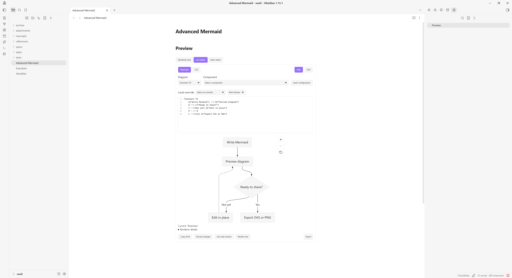

# Advanced Mermaid User Guide

In Mermaid, you describe a diagram with text. Advanced Mermaid renders that text inside your note and lets you edit it alongside the result. Start with the [installation steps](../README.md#installation) and the [starter flowchart](../README.md#try-a-diagram).

- [Install or update manually](#install-manually)
- [Edit and preview a diagram](#edit-and-preview-a-diagram)
- [Change how a diagram looks](#change-how-a-diagram-looks)
- [Export a diagram](#export-a-diagram)
- [Troubleshoot](#troubleshooting)

## Install manually

1. Under **Assets** on a single GitHub release, download `main.js`, `manifest.json`, and `styles.css`. [GitHub Releases](https://github.com/indubyagee/advanced-mermaid/releases)
2. In your vault’s configuration folder, create `plugins/advanced-mermaid` if needed. With the default configuration folder, the full location is `<Vault>/.obsidian/plugins/advanced-mermaid/`. If you use **Override config folder**, use the folder you configured. [Obsidian’s configuration folder](https://obsidian.md/help/configuration-folder)
3. Place the three files directly in `advanced-mermaid`. Restart Obsidian, then enable **Advanced Mermaid** under **Settings → Community plugins**.

To update a manual installation, replace the same three files with the assets from the new release and restart Obsidian. Open **Settings → Community plugins** to check the installed version.

## Edit and preview a diagram

Open the note in **Live Preview**. You can select it using the view icon in Obsidian’s status bar. Put the opening and closing lines of your `mermaid` or `pele` block on their own lines. Keep the block outside lists, quotes, and callouts to use the inline editor. [Obsidian’s viewing and editing modes](https://obsidian.md/help/edit-and-read)

| Button above the block | What it does |
| --- | --- |
| **Rendered view** | Shows the diagram with zoom and export controls. Select it when you finish editing. |
| **Live editor** | Shows editable source and an updating preview in the same block. |
| **Static editor** | Opens the original Markdown code block for direct editing in the note. |

You can open one Live editor per note pane. Reading view and note embeds show the rendered diagram. **Source mode** shows the original Markdown.

In the Live editor, use the **Mermaid** tab to write diagram text. Edits go directly into the note and share its undo history. The **Pele** tab shows the rendered diagram, and **SVG** shows its read-only vector markup. Use **CSS** for styles that apply to this block only.

- Use **Diagram** to set the diagram type or direction, and **Component** to insert a snippet for that type. **Insert configuration** adds editable YAML settings at the top of the block. Review the body after changing diagram types, since it may use syntax from the previous type. [Live editor syntax controls](live-editor-syntax.md)
- Select **Render now** or press **Ctrl+Enter** or **Cmd+Enter** if you want to refresh immediately. Press **Esc** to return to the rendered diagram. **Tab** indents source lines and **Shift+Tab** outdents them.
- Use the gutter arrows to fold or expand indented source. **Ctrl+Shift+[** folds and **Ctrl+Shift+]** expands; on macOS, use **Cmd+Alt+[** and **Cmd+Alt+]**. Folding changes only the source view. Indent guides and fold arrows have separate light/dark colors under **Live Editor → Editor appearance**.
- Use **+**, **−**, and **Reset zoom** to inspect a diagram. After zooming, drag to pan or focus the diagram and use the arrow keys.
- In Advanced Mermaid settings, use **Editor layout** to choose **Auto**, **Side by side**, or **Stacked**. Narrow panes stack the source and preview. Set **Open editor** to **Focused block** if you want the Live editor to open when you enter a diagram block. [Live editor settings](settings-menu.md#live-editor)

From the command palette, **Advanced Mermaid: Toggle inline editor** opens or closes the Live editor for the current block. **Advanced Mermaid: Render inline diagram** refreshes the open preview.

### Recover a style draft

The **CSS** tab saves valid changes as comments in the diagram block. An invalid draft stays in the editor until you fix it or select **Discard changes**. If the block changed elsewhere in the note, select **Use note version** to load the saved version. Use **Copy draft** first if you want to keep your draft.

If a pane closes unexpectedly, run **Advanced Mermaid: Recover inline drafts** from the command palette. Open a draft and copy the text you want to recover. These copies are available for the current Obsidian session.

## Change how a diagram looks

Open **Settings → Advanced Mermaid**. The settings names below follow the current source. In release 0.3.2, use **Display settings** for sizing, **Global style settings** for shared styles, **Diagram-specific style settings** for a single type, and **Preset class settings** for reusable styles. Obsidian’s settings search can also find individual controls.

### Set defaults for your vault

- Use **Diagram Display** to change alignment and set width and height limits. To make small diagrams use more space, choose an available width such as **Full** or **Full Pane** and turn on **Fill available space**. Which widths appear depends on whether you use the Minimal Theme Settings plugin. [Display options and defaults](settings-menu.md#display)
- Use **Diagram Styles → All diagrams** to set common colors, fonts, and label sizes. Colors follow Obsidian’s theme by default. You can set separate colors for light and dark mode.
- To style one type of diagram, open **By diagram type**, choose a type such as **Flowchart**, and turn off **Use styles from All diagrams**. In 0.3.2 this toggle is called **Use global styles**. The diagram type can inherit any value you leave empty. [Style settings](settings-menu.md#styles)

Select **Show example** where available to see how the current settings look on a sample diagram.

### Change one diagram

In the Live editor, open **Local override** and choose the setting you want to change. The editor inserts a comment with an editable value or selects the value if it already exists. Select **Maximum height** and enter `30vh` to cap this diagram at 30% of the window height. For colors, choose **Both themes**, **Light**, or **Dark**. These changes travel with the diagram because the comments are part of the note. [Local override syntax](technical-reference.md#per-diagram-configuration)

To change a diagram setting such as the spacing between flowchart nodes, use **Insert configuration**. It adds or fills in diagram frontmatter, the YAML between `---` lines at the top of the code block. To set the same spacing for a whole diagram type, use **Use custom frontmatter** in that type’s settings. [Frontmatter example](settings-menu.md#styles)

### Reuse a style with preset classes

A preset class is a named combination of colors and border settings. In the starter flowchart, change `B[Review]` to `B[Review]:::PRESET3` to apply the built-in **PRESET3** style to the Review box. If you already have a custom library, use an alias from your own list.

Open **Preset classes** in Advanced Mermaid settings to create, edit, or view aliases. Use the same alias wherever you want the same style. Aliases are case-sensitive. [Preset class examples and supported diagram types](preset-classes.md)

## Export a diagram

Open **Export** below a rendered diagram or in the Live editor.

| Choose | Use it to |
| --- | --- |
| **Save SVG** | Create a vector image that stays sharp when resized. |
| **Copy SVG** | Copy SVG source text for use in a document or editor that accepts SVG markup. If clipboard access fails, copy the text from the dialog. |
| **Save PNG** or **Copy PNG** | Save an image to the vault or paste it into an app that accepts images from the clipboard. Use **Save PNG** if image clipboard access is unavailable. |
| **Save canvas** | Turn a Flowchart or Agentflow into editable cards and connections in Obsidian. |

When saving, choose an existing vault folder or select **Vault root**. The dialog shows the destination and suggests folders as you type. Saved exports get unique names. SVG and PNG include the entire diagram at its original layout, even if you zoomed in or set a width or height limit in the note.

### Save an editable Canvas

1. Render a Flowchart (`flowchart`, `graph`, or `flowchart-elk`) or Agentflow (`agentflow-beta`).
2. Select **Export → Save canvas**. The dialog starts in the source note’s folder. Choose where to save and select **Save**.
3. Select **Open canvas** to open it in a new tab. Enable **Settings → Core plugins → Canvas** if Obsidian cannot open the file.

Canvas uses its own cards, groups, and connections, so the result looks like a native Obsidian canvas. Flowchart document shapes and Agentflow reference documents become file cards, with a new Markdown note for each card in the selected folder. If a save fails after some notes have been created, retry in the same dialog to reuse those notes. [Canvas conversion details and limits](technical-reference.md#export-formats-and-limits)

## Privacy

The plugin renders and exports diagrams locally using its bundled renderer and local fonts. It skips images inside diagram blocks to prevent automatic image requests. Their text labels still appear.

## Troubleshooting

| What you see | What to try |
| --- | --- |
| The plugin is missing after a manual install | Check your Obsidian version and confirm that the three release files sit directly in the `advanced-mermaid` folder. Restart Obsidian and enable the plugin under **Community plugins**. |
| The diagram stays as text | Check that the opening line uses `mermaid` or `pele` and that the closing backticks or tildes are present. Switch to **Reading view**, or move the cursor outside the block in **Live Preview**. |
| The Live editor button is missing | Use **Live Preview** with a complete, top-level code block and check **Enable inline editor** in Advanced Mermaid settings. |
| The preview is dimmed or **Export** is missing | Fix the diagram or style error shown near the preview. The editor may be showing the last valid version. Use **Technical details** or **Copy error** if you need the diagnostic. |
| Width, height, or colors look different from the settings | Check the block for a **Local override**. For colors, also check the diagram type’s settings and any `style` or `classDef` statements in the source. |
| A PNG is too large or a copy action fails | Use **Save SVG** for oversized diagrams. For clipboard failures, focus the diagram window and retry, or use the corresponding save action. |

For a reproducible problem, include the Advanced Mermaid version, Obsidian version, operating system, and a small example diagram with the diagnostic. [Report an issue](https://github.com/indubyagee/advanced-mermaid/issues)
