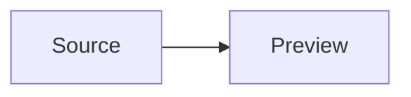

# Advanced Mermaid 0.2.0 fixtures

Use a development vault with the new build. The examples assume the original
preset library. In Live Preview select **Live editor**, insert an override, undo
it once, then choose **Static editor** and verify the original fence remains.
With focused activation enabled, an explicit Static choice must stay closed until
Live editor is selected. Inactive Mermaid blocks and Reading view remain native.

## Native Mermaid outside the inline editor



## Flowchart nodes and subgraphs

```pele
flowchart LR
 subgraph GROUP[Review]
  A[Draft]:::ALT1 --> B[Approved]:::ALT2
 end
 class GROUP ALT
```

## State

```pele
stateDiagram-v2
 Idle --> Active
 class Idle ALT1
```

## Agentflow

```pele
agentflow-beta
 A[Input]:::ALT1 --> B[Task]:::ALT2
```

## Mindmap

```pele
mindmap
 root((Root))
  Shaped[Shaped]
   :::ALT1
  Text only
   :::ALT2
```

## TreeView: labels remain text-only

```pele
treeView-beta
root/ :::ALT1
  file.ts :::ALT2
```

## Treemap

```pele
treemap-beta
 "Group"
  "Item": 10:::ALT1
```

## Local overrides

```pele
%% advanced-mermaid: align=left max-width=wide
%% advanced-mermaid-style:v1
%% .theme-dark .pele { --pele-surface: #123456; }
%% advanced-mermaid-style:end
flowchart LR
 A[Local] --> B[Inherited]
```

Verify paired Light/Dark controls and independent resets, fractional widths,
numeric inheritance resets, form/text preset editing, invalid draft protection,
confirmed deletion, retained type overrides, settings search, save/reload, two
panes showing the same note, and matching SVG/PNG exports in both themes.
